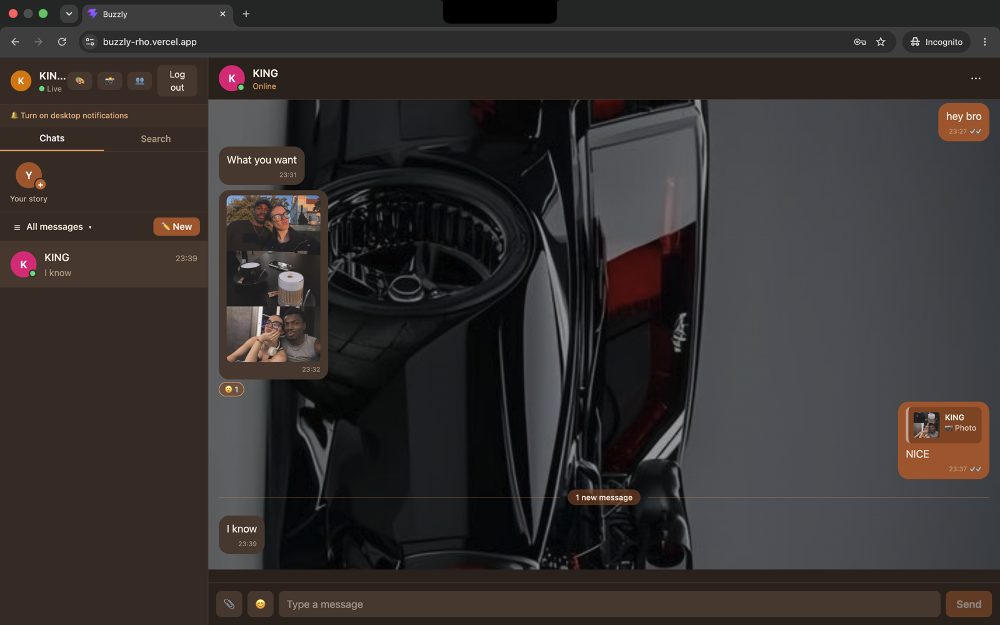
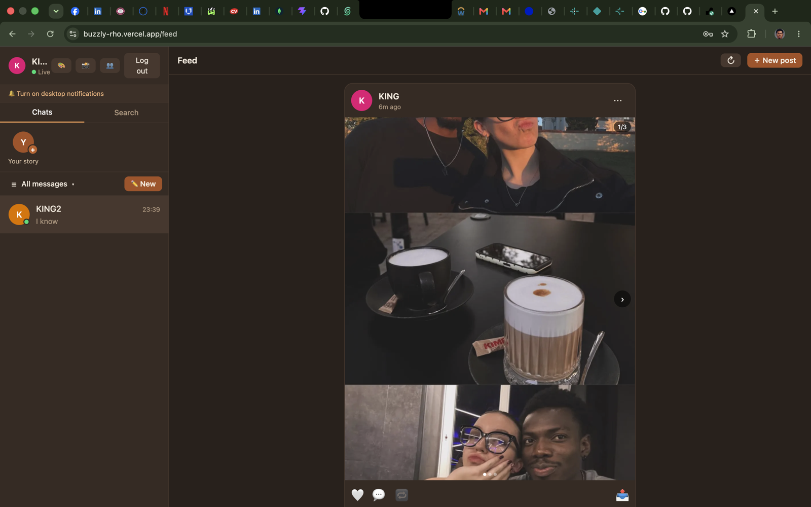
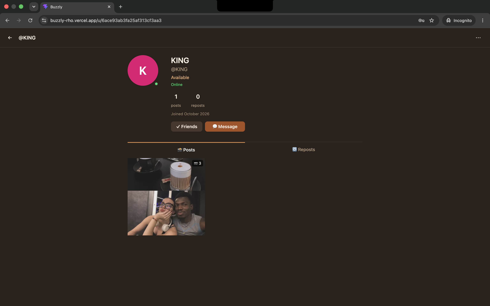
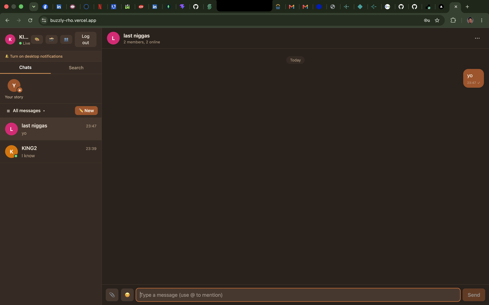
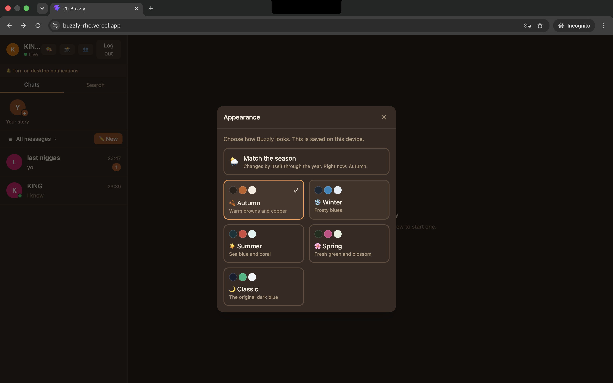
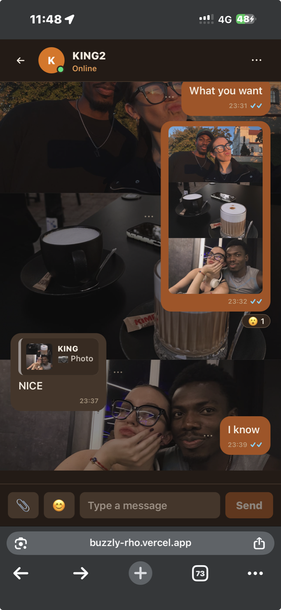
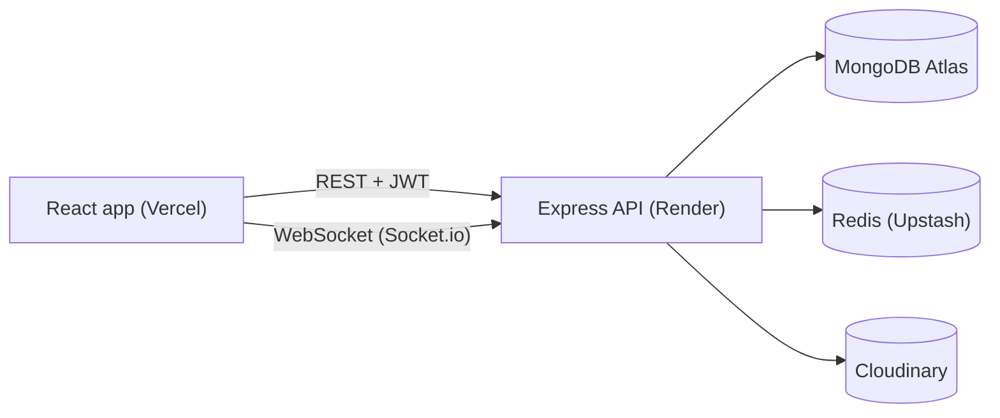

# 🐝 Buzzly

> A real-time chat and photo-sharing app: private messages, groups, stories, a photo feed and Instagram-style profiles.

[](https://github.com/Kingoche-hash/buzzly/actions/workflows/ci.yml)


**🔗 Live demo: [buzzly-rho.vercel.app](https://buzzly-rho.vercel.app)**

> The demo runs on free hosting. If nobody used it recently, the first request can take about a minute while the server wakes up. Create two accounts (two browsers, or a phone and a computer) to see the real-time features.

## Screenshots

| Chat | Feed |
|---|---|
|  |  |

| Profile | Group info |
|---|---|
|  |  |

| Seasonal themes | On a phone |
|---|---|
|  |  |

## Features

**Messaging**
- Private one-to-one chats and group chats, delivered instantly over WebSockets
- Typing indicators, online status and last seen (each can be switched off in privacy settings)
- Sent, delivered and read receipts (✓, ✓✓, blue ✓✓), with an option to hide your read receipts
- Reply to a message, edit within 15 minutes, delete for me or for everyone, emoji reactions, an emoji picker and @mentions in groups
- Photos, PDFs and documents, with type, size and real-content checks
- Message search with filters and pagination, and jump to a result inside its conversation
- A "new messages" line, a scroll-to-bottom button, drafts saved per chat, and retry for failed sends
- Pin, mute, report as spam and delete chats, plus colour and photo wallpapers per chat

**Groups**
- Admin roles, add and remove members, edit the group name and photo, leave a group
- Notes in the chat such as "Alice added Bob"

**Social**
- 24-hour stories (text or photo) with a viewers list, and replies that arrive in chat
- A photo feed with multi-photo posts, likes, comments, reposts and sharing to chats
- Instagram-style profile pages with a posts grid and a reposts tab
- Friend requests, unfriend, and a "who can message me" setting
- Blocking with a blocked users list, and reporting people, posts and messages

**Experience**
- Seasonal themes (autumn, winter, summer, spring, classic), or follow the real season automatically
- Responsive layout for desktop and phone, toasts, desktop notifications, unread badges, loading skeletons and error states

## Tech stack

| Area | Technology |
|---|---|
| Website | React, Vite, React Router, Tailwind CSS, Axios, Socket.io client |
| Server | Node.js, Express, Socket.io, Mongoose, Zod, JWT, bcrypt, Helmet |
| Data | MongoDB Atlas (data), Redis on Upstash (presence and login lockout) |
| Files | Cloudinary |
| Testing | Node's built-in test runner, Supertest, socket.io-client, Vitest |
| Hosting | Vercel (website), Render (server), GitHub Actions (CI) |

## Architecture



- **Separate website and server.** The server never renders pages. It exposes a REST API and a Socket.io endpoint.
- **Layered server.** Routes, controllers, services, then models. Business rules live in services, not in route files or React components.
- **Authorization everywhere.** Every conversation, message, story and post route checks who is asking. Rooms can only be joined by members, and blocks work in both directions.
- **Redis for live state.** Which sockets belong to which user is stored in Redis, not in browser state. A short grace period stops a page refresh from flashing "offline".
- **Cursor pagination** for message history, feeds and comments, so nothing loads a whole history at once.
- **Files never touch the database.** Uploads are validated, stored in Cloudinary, and only URLs and metadata are saved.

## Getting started

**Requirements:** Node.js 20 or newer, and free accounts at MongoDB Atlas, Upstash and Cloudinary.

```bash
git clone https://github.com/Kingoche-hash/buzzly.git
cd buzzly

# Server
cd server
cp .env.example .env      # then fill in the values (see the table below)
npm install
npm run dev               # http://localhost:5001

# Website (in a second terminal)
cd client
cp .env.example .env
npm install
npm run dev               # http://localhost:5173
```

### Server environment variables (`server/.env`)

| Name | Purpose |
|---|---|
| `NODE_ENV` | `development` or `production` |
| `PORT` | Server port (default 5001) |
| `CLIENT_URL` | Allowed website address(es), comma-separated, used for CORS |
| `TRUST_PROXY` | Number of hosting proxies in front of the server (0 locally, 1 on most hosts) |
| `MONGODB_URI` | MongoDB connection string |
| `MONGODB_TEST_URI` | A separate database for tests. Its name **must end in `_test`** |
| `REDIS_URL` | Redis connection string (`rediss://...`) |
| `REDIS_KEY_PREFIX` | Optional text put in front of every Redis key |
| `JWT_SECRET` | At least 32 random characters |
| `JWT_EXPIRES_IN` | Token lifetime, for example `7d` |
| `CLOUDINARY_CLOUD_NAME`, `CLOUDINARY_API_KEY`, `CLOUDINARY_API_SECRET` | Cloudinary credentials |

### Website environment variables (`client/.env`)

| Name | Purpose |
|---|---|
| `VITE_API_URL` | The API address, ending in `/api` |
| `VITE_SOCKET_URL` | The server address, without `/api` |

## Project structure

```text
buzzly/
├── client/                 React + Vite website
│   └── src/
│       ├── components/     Reusable pieces and dialogs
│       ├── pages/          Chat, profile, post, login, register
│       ├── hooks/          Data and behaviour (useMessages, usePosts, ...)
│       ├── context/        Auth, socket, presence, typing, toasts
│       ├── services/       API requests
│       └── utils/          Pure helper functions (unit tested)
├── server/
│   ├── config/             Environment, database, Redis, Cloudinary
│   ├── controllers/        Thin request handlers
│   ├── middleware/         Auth, validation, uploads, rate limits
│   ├── models/             Mongoose schemas
│   ├── routes/             Express routers
│   ├── services/           Business logic
│   ├── socket/             Socket.io setup, handlers, presence
│   ├── validators/         Zod schemas
│   └── tests/              API, permission and socket tests
├── docs/                   API reference and screenshots
└── .github/workflows/      Continuous integration
```

## API and real-time events

The full list of endpoints and Socket.io events is in **[docs/API.md](docs/API.md)**.

## Security

- Passwords hashed with bcrypt. JWT sessions. Changing a password signs out every older session
- Login lockout after 10 failed attempts (tracked in Redis) and a constant-time check so unknown emails can't be detected
- Rate limits on the whole API and on logins, uploads, replies, posts and message actions
- Every request body, query and parameter validated with Zod. Allowed origins checked for CORS
- Uploads checked by type, size and actual file contents, and stored outside the database
- Helmet security headers, hidden error details in production, secrets only in environment variables
- Blocks, friend settings, group roles and conversation membership enforced on the server

## Testing

```bash
cd server && npm test      # API, permissions, uploads and Socket.io tests
cd client && npm test      # utility tests
```

Server tests run against a separate database (a name ending in `_test` is required, and anything else is refused) and use an in-memory Redis. They never call Cloudinary. GitHub Actions runs everything on each push.

## Deployment

| Part | Host | Notes |
|---|---|---|
| Website | Vercel | Root directory `client`, with `VITE_API_URL` and `VITE_SOCKET_URL` set |
| Server | Render | Root directory `server`, start command `npm start`, health check `/api/health` |
| Database | MongoDB Atlas | Separate production database and user |
| Redis | Upstash | Production uses its own `REDIS_KEY_PREFIX` |

## Known limitations and roadmap

- The server runs as a single instance. Scaling out needs the Socket.io Redis adapter and a shared privacy cache
- Not built yet: a full-screen image viewer, archiving chats, push notifications and an installable app, password reset by email, and light themes
- Group members who block each other still see each other's messages inside a shared group

## License

[MIT](LICENSE)
